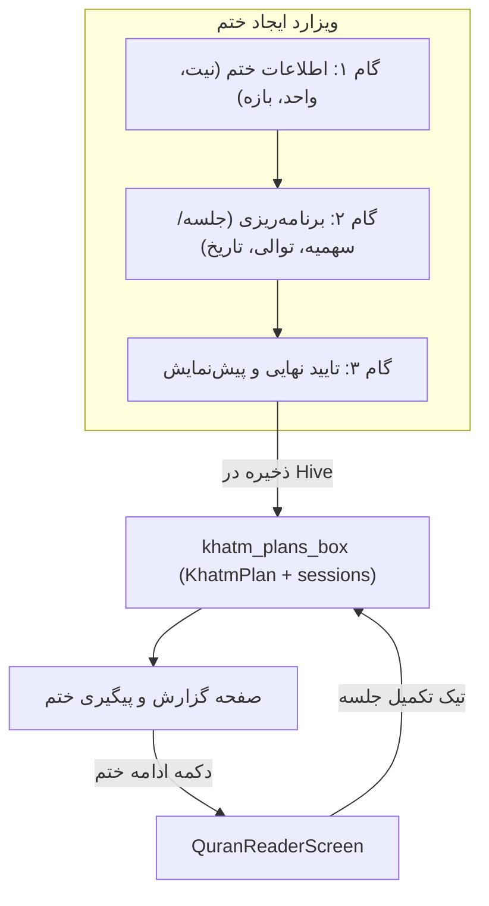

# سند جامع مشخصات فنی فیچر «ختم و برنامه مطالعه قرآن»

**نسخه:** `v2.1`  |  **وضعیت:** تایید شده برای پیاده‌سازی

---

## فهرست مطالب

1. [معماری کلان](#۱-معماری-کلان)
2. [باگ‌ها و اصلاحات فنی نسخه جدید](#۲-باگها-و-اصلاحات-فنی)
3. [گام ۱: اطلاعات ختم](#۳-گام-۱)
4. [گام ۲: برنامه‌ریزی ختم](#۴-گام-۲)
5. [گام ۳: تایید نهایی](#۵-گام-۳)
6. [صفحه گزارش و تایم‌لاین](#۶-صفحه-گزارش)
7. [موتور محاسباتی (Slicing & Calendar)](#۷-موتور-محاسباتی)
8. [مدل داده و انتیتی‌ها](#۸-مدل-داده)
9. [سازگاری با StudyPlan فعلی](#۹-سازگاری)
10. [ارتقای JalaliDate](#۱۰-ارتقای-jalalidate)
11. [نقشه ناوبری قرآن](#۱۱-نقشه-ناوبری)
12. [معماری ویجت‌ها و تفکیک کامپوننت‌ها](#۱۲-معماری-ویجتها)
13. [اتصال به صفحه ریدر قرآن (Reader Integration)](#۱۳-اتصال-به-ریدر)
14. [سناریوهای مرزی (Edge Cases)](#۱۴-edge-cases)
15. [نقشه راه پیاده‌سازی گام به گام](#۱۵-نقشه-راه)

---

## ۱. معماری کلان



### ساختار دایرکتوری فیچر

```
lib/features/khatm/
├── domain/
│   ├── entities/
│   │   ├── khatm_plan.dart
│   │   ├── khatm_session_item.dart
│   │   └── khatm_enums.dart
│   └── services/
│       ├── khatm_slicing_engine.dart     # برش بازه (دو حالت جلسه و سهمیه)
│       ├── khatm_date_engine.dart        # محاسبه تاریخ جلسات با جهش تقویمی
│       └── khatm_quran_resolver.dart     # تبدیل سهمیه → آیه و صفحه ریدر
├── application/
│   └── controllers/
│       ├── khatm_wizard_controller.dart
│       ├── khatm_detail_controller.dart
│       └── khatm_list_controller.dart
├── infrastructure/
│   └── datasources/
│       ├── khatm_local_datasource.dart   # عملیات Hive روی khatm_plans_box
│       └── khatm_quran_data.dart         # دیتای استاتیک صفحات جزء و حزب
└── presentation/
    ├── ui/
    │   ├── create_khatm_wizard_screen.dart
    │   ├── khatm_detail_report_screen.dart
    │   └── khatm_list_screen.dart
    └── widgets/
        ├── wizard/
        │   ├── khatm_step_indicator.dart
        │   ├── khatm_title_input.dart
        │   ├── khatm_unit_type_selector.dart
        │   ├── khatm_range_input.dart
        │   ├── khatm_planning_mode_radio.dart
        │   ├── khatm_session_count_input.dart
        │   ├── khatm_cadence_selector.dart
        │   ├── khatm_weekday_selector.dart
        │   ├── khatm_jalali_date_picker.dart
        │   ├── khatm_live_preview_card.dart
        │   ├── khatm_wizard_navigation_buttons.dart
        │   └── khatm_confirmation_card.dart
        ├── report/
        │   ├── khatm_progress_donut_chart.dart
        │   ├── khatm_date_range_card.dart
        │   ├── khatm_session_timeline_header.dart
        │   ├── khatm_session_timeline.dart
        │   ├── khatm_session_tile.dart
        │   └── khatm_continue_button.dart
        └── reader/
            └── khatm_reader_bar.dart
```

---

## ۲. باگ‌ها و اصلاحات فنی نسخه جدید (v2.1)

| # | مسئله / باگ | توضیح و علت | راه‌حل قطعی |
|:---:|:---|:---|:---|
| 1 | **تطابق تعداد حزب با حبل‌المتین** | در حبل‌المتین و عرف ایران، کل قرآن **۱۲۰ حزب** است (هر جزء ۴ حزب). دیتابیس پروژه (`quran.db`) دارای ۲۴۰ ربع‌حزب است. | حداکثر حزب = **۱۲۰** (هر حزب = ۲ ربع‌حزب `(hizb - 1) * 2 + 1`). کاملاً منطبق با `SqfliteQuranNavigationServiceImpl`. |
| 2 | **الگوریتم برش با سهمیه واحد** | در مستند قبلی فقط تقسیم بر اساس تعداد جلسه بود؛ اگر کاربر سهمیه مشخص می‌داد (مثلاً هر جلسه ۱۰ صفحه) تابعی وجود نداشت. | افزودن متد `sliceByUnitQuota` با سهمیه‌های فیکس و باقی‌مانده در جلسه آخر. |
| 3 | **باگ فرمول تاریخ پایان** | ضرب `cadenceStep × (N - 1)` برای روزهای خاص هفته غلط بود. | مقدار `endDate = dates.last` مستقیماً از تاریخ آخرین جلسه برداشته می‌شود. |
| 4 | **عدم تطابق تاریخ شروع با روزهای انتخابی** | اگر کاربر دوشنبه‌ها را انتخاب کند اما تاریخ شروع جمعه باشد، جلسه اول نباید در جمعه بیفتد. | اسنپ تاریخ شروع به اولین روز انتخابی معتبر در صورت عدم انطباق. |
| 5 | **انحراف ساعت تابستانی (DST)** | متد `current.add(Duration(days: 1))` به دلیل تغییر ساعت ۲۴ ساعته انحراف ایجاد می‌کند. | استفاده از `DateTime(current.year, current.month, current.day + step)`. |
| 6 | **تصحیح صفحات حزب ۴۴ و ۵۴** | مقادیر جدول تقریب با `quran.db` تفاوت جزئی ۱ صفحه‌ای داشتند. | حزب ۴۴ $\rightarrow$ صفحه ۴۳۱، حزب ۵۴ $\rightarrow$ صفحه ۵۳۱ بر اساس استعلام مستقیم SQLite. |

---

## ۳. گام ۱: اطلاعات ختم

### فیلدها و کامپوننت‌ها (منطبق بر اسکرین‌شات ۱)

1. **نیت ختم (\*):** فیلد ورودی متن الزامی (`KhatmTitleInput`).
2. **نوع ختم (\*):** منوی کشویی انتخاب واحد (`KhatmUnitTypeSelector`):
   - صفحه (Page) $\rightarrow$ حداکثر **۶۰۴**
   - حزب (Hizb) $\rightarrow$ حداکثر **۱۲۰**
   - جزء (Juz) $\rightarrow$ حداکثر **۳۰**
   - سوره (Surah) $\rightarrow$ حداکثر **۱۱۴**
   - آیه (Ayah) $\rightarrow$ حداکثر **۶۲۳۶**
3. **محدوده از / تا (\*):** دو فیلد عددی در یک سطر افقی (`KhatmRangeInput`):
   - «از [واحد]»: حداقل ۱ تا حداکثر مقدار `تا`
   - «تا [واحد]»: از مقدار `از` تا `maxUnit`

---

## ۴. گام ۲: برنامه‌ریزی ختم

### فیلدها و کامپوننت‌ها (منطبق بر اسکرین‌شات ۲)

1. **نوع برنامه‌ریزی (\*):** رادیوباتن دو گزینه‌ای (`KhatmPlanningModeRadio`):
   - **«براساس جلسه»:** کاربر تعداد کل جلسات را وارد می‌کند.
   - **«براساس [واحد]»:** کاربر سهمیه هر جلسه را وارد می‌کند (مثلاً سهمیه هر جلسه بر اساس حزب).
2. **مقدار ورودی (\*):** فیلد عددی متغیر بر اساس انتخاب بالا (`KhatmSessionCountInput`):
   - لیبل: «تعداد جلسات \*» یا «تعداد [واحد] در هر جلسه \*».
3. **نحوه برگزاری (\*):** دراپ‌داون (`KhatmCadenceSelector`):
   - روزانه (Daily)
   - یک‌روزدرمیان (Every Other Day)
   - هفتگی (Weekly)
   - روزهای خاص هفته (Custom Weekdays) $\rightarrow$ نمایش چیپ‌های شنبه تا جمعه (`KhatmWeekdaySelector`).
4. **تاریخ شروع (\*):** فیلد تقویم شمسی (`KhatmJalaliDatePicker`)، پیش‌فرض: امروز.
5. **پیش‌نمایش زنده:** کادر هایلایت (`KhatmLivePreviewCard`):
   - «تعداد [واحد] در هر جلسه = X»
6. **دکمه‌های ناوبری:** «ادامه» (سبز پررنگ) و «بازگشت» (بوردر سبز) (`KhatmWizardNavigationButtons`).

---

## ۵. گام ۳: تایید نهایی

کارت خلاصه اطلاعات ختم قبل از ثبت نهایی (`KhatmConfirmationCard`):
- نام ختم (نیت)
- بازه تلاوت (مثلاً «از صفحه ۱ تا ۶۰۴»)
- تعداد کل جلسات
- سهمیه هر جلسه (مثلاً «حدود ۱۲۱ صفحه» یا «دقیقاً ۱۰ صفحه»)
- نحوه برگزاری (روزانه، هفتگی و...)
- تاریخ شروع (شمسی)
- تاریخ پایان محاسبه‌شده (شمسی)
- دکمه ثبت و ایجاد ختم $\rightarrow$ تولید مدل و ذخیره در Hive و هدایت به صفحه گزارش ختم.

---

## ۶. صفحه گزارش و تایم‌لاین (منطبق بر اسکرین‌شات ۳)

1. **کارت چارت پیشرفت (`KhatmProgressDonutChart`):**
   - عنوان: گزارش «نام ختم»
   - چارت دونات: بخش زرد (صفحات باقی‌مانده) + بخش سبز (صفحات تلاوت‌شده).
   - دو ردیف راهنما: `X [واحد] باقی مانده` و `Y [واحد] تلاوت شده`.
2. **کارت بازه زمانی (`KhatmDateRangeCard`):**
   - سطر دو ستونه: «شروع ختم: ۱۴۰۵/۰۷/۲۳» و «پایان ختم: ۱۴۰۵/۰۷/۲۷».
3. **تایم‌لاین جلسات:**
   - عنوان: «گزارش تلاوت براساس تاریخ»
   - هدر سه ستونه: «ردیف» | «عنوان» | «تاریخ» (`KhatmSessionTimelineHeader`).
   - آیتم‌های تایم‌لاین (`KhatmSessionTile`):
     - ستون ردیف: شماره جلسه در دایره متصل به خط‌چین عمودی.
     - ستون عنوان: مثلاً «صفحه عثمان طه ۱ تا ۱۲۱».
     - ستون تاریخ: تاریخ شمسی مقرر.
     - وضعیت آیکون: دایره توخالی (آینده)، تیک سبز (تکمیل شده)، هشدار (عقب‌افتاده).
     - قابلیت تیک/آنتیک دستی وضعیت جلسه.
4. **دکمه ادامه ختم (`KhatmContinueButton`):**
   - قرارگیری در پایین صفحه.
   - محاسبه اولین جلسه ناتمام و هدایت مستقیم کاربر به ریدر قرآن در موقعیت مشخص‌شده.

---

## ۷. موتور محاسباتی (Slicing & Calendar)

### ۷.۱ موتور تقسیم سهمیه (KhatmSlicingEngine)

```dart
class KhatmSlicingEngine {
  /// ۱. تقسیم بر اساس تعداد جلسات (Remainder-Balanced)
  static List<({int from, int to})> sliceBySessionCount({
    required int rangeFrom,
    required int rangeTo,
    required int sessionCount,
  }) {
    final total = rangeTo - rangeFrom + 1;
    final safeCount = sessionCount.clamp(1, total);
    final base = total ~/ safeCount;
    final remainder = total % safeCount;

    final result = <({int from, int to})>[];
    int cursor = rangeFrom;
    for (int i = 0; i < safeCount; i++) {
      final quota = base + (i < remainder ? 1 : 0);
      result.add((from: cursor, to: cursor + quota - 1));
      cursor += quota;
    }
    return result;
  }

  /// ۲. تقسیم بر اساس سهمیه ثابت هر جلسه (Exact Quota)
  static List<({int from, int to})> sliceByUnitQuota({
    required int rangeFrom,
    required int rangeTo,
    required int quotaPerSession,
  }) {
    final total = rangeTo - rangeFrom + 1;
    final safeQuota = quotaPerSession.clamp(1, total);
    final result = <({int from, int to})>[];

    int cursor = rangeFrom;
    while (cursor <= rangeTo) {
      final end = (cursor + safeQuota - 1).clamp(cursor, rangeTo);
      result.add((from: cursor, to: end));
      cursor = end + 1;
    }
    return result;
  }
}
```

### ۷.۲ موتور تقویم و تاریخ جلسات (KhatmDateEngine)

```dart
class KhatmDateEngine {
  static List<DateTime> generateSessionDates({
    required DateTime startDate,
    required int sessionCount,
    required KhatmCadence cadence,
    List<int> selectedWeekdays = const [], // 1 = Monday, 7 = Sunday
  }) {
    final dates = <DateTime>[];
    if (sessionCount <= 0) return dates;

    DateTime current = DateTime(startDate.year, startDate.month, startDate.day);

    // اسنپ تاریخ شروع به اولین روز انتخابی در صورت انتخاب روزهای خاص
    if (cadence == KhatmCadence.customWeekdays && selectedWeekdays.isNotEmpty) {
      while (!selectedWeekdays.contains(current.weekday)) {
        current = DateTime(current.year, current.month, current.day + 1);
      }
    }

    for (int i = 0; i < sessionCount; i++) {
      dates.add(current);
      switch (cadence) {
        case KhatmCadence.daily:
          current = DateTime(current.year, current.month, current.day + 1);
        case KhatmCadence.everyOtherDay:
          current = DateTime(current.year, current.month, current.day + 2);
        case KhatmCadence.weekly:
          current = DateTime(current.year, current.month, current.day + 7);
        case KhatmCadence.customWeekdays:
          current = _nextSelectedWeekday(current, selectedWeekdays);
      }
    }
    return dates;
  }

  static DateTime _nextSelectedWeekday(DateTime current, List<int> weekdays) {
    if (weekdays.isEmpty) {
      return DateTime(current.year, current.month, current.day + 1);
    }
    var next = DateTime(current.year, current.month, current.day + 1);
    for (int i = 0; i < 7; i++) {
      if (weekdays.contains(next.weekday)) return next;
      next = DateTime(next.year, next.month, next.day + 1);
    }
    return next;
  }
}
```

---

## ۸. مدل داده و انتیتی‌ها

### ۸.۱ Enums (`khatm_enums.dart`)

```dart
enum KhatmUnitType { page, hizb, juz, surah, ayah }
enum KhatmPlanningMode { bySessionCount, byUnitQuota }
enum KhatmCadence { daily, everyOtherDay, weekly, customWeekdays }
enum KhatmSessionStatus { pending, current, completed, missed }
```

### ۸.۲ `KhatmPlan`

```dart
class KhatmPlan {
  final String id;
  final String title;
  final KhatmUnitType unitType;
  final int rangeFrom;
  final int rangeTo;
  final KhatmPlanningMode planningMode;
  final int sessionCount;
  final int quotaPerSession;
  final KhatmCadence cadence;
  final List<int> selectedWeekdays;
  final DateTime startDateTime;
  final DateTime endDateTime;
  final List<KhatmSessionItem> sessions;
  final DateTime createdAt;
  final bool isArchived;

  // Computed Properties
  int get totalUnits => rangeTo - rangeFrom + 1;
  int get completedSessionsCount => sessions.where((s) => s.isCompleted).length;
  int get completedUnits => sessions
      .where((s) => s.isCompleted)
      .fold(0, (sum, s) => sum + (s.toUnit - s.fromUnit + 1));
  int get remainingUnits => totalUnits - completedUnits;
  double get progressPercentage =>
      totalUnits > 0 ? (completedUnits / totalUnits).clamp(0.0, 1.0) : 0.0;
  bool get isCompleted => completedSessionsCount >= sessionCount;

  KhatmSessionItem? get nextPendingSession {
    for (final s in sessions) {
      if (!s.isCompleted) return s;
    }
    return null;
  }

  String get unitLabel {
    switch (unitType) {
      case KhatmUnitType.page: return 'صفحه';
      case KhatmUnitType.hizb: return 'حزب';
      case KhatmUnitType.juz: return 'جزء';
      case KhatmUnitType.surah: return 'سوره';
      case KhatmUnitType.ayah: return 'آیه';
    }
  }
}
```

### ۸.۳ `KhatmSessionItem`

```dart
class KhatmSessionItem {
  final int sessionIndex;
  final int fromUnit;
  final int toUnit;
  final DateTime scheduledDate;
  final bool isCompleted;
  final DateTime? completedAt;

  int get unitCount => toUnit - fromUnit + 1;

  String computeTitle(KhatmUnitType unitType) {
    final prefix = unitType == KhatmUnitType.page ? 'صفحه عثمان طه' : unitType.name;
    return '$prefix ${fromUnit.toPersianDigit()} تا ${toUnit.toPersianDigit()}';
  }

  KhatmSessionStatus computeStatus(DateTime now) {
    if (isCompleted) return KhatmSessionStatus.completed;
    final today = DateTime(now.year, now.month, now.day);
    final scheduled = DateTime(scheduledDate.year, scheduledDate.month, scheduledDate.day);
    if (scheduled.isAtSameMomentAs(today)) return KhatmSessionStatus.current;
    if (scheduled.isBefore(today)) return KhatmSessionStatus.missed;
    return KhatmSessionStatus.pending;
  }
}
```

---

## ۹. سازگاری با StudyPlan فعلی

* **ایزوله‌سازی کامل:** فیچر ختم در باکس جدید Hive به نام `khatm_plans_box` ذخیره می‌شود و هیچ فیلد یا ایندکسی از `study_plans_box` را دستکاری نمی‌کند.
* **بدون تداخل:** کنترلرها و روترهای ویزارد ختم کاملاً مستقل عمل می‌کنند و ریسک خراب شدن داده‌های قبلی کاربران صفر است.

---

## ۱۰. ارتقای JalaliDate

متدهای تکمیلی تقویم شمسی در `lib/common/utils/jalali_date.dart`:

```dart
extension JalaliDateExtensions on JalaliDate {
  /// تبدیل معکوس دقیق شمسی به میلادی (الگوریتم پورنادر)
  DateTime toDateTime() {
    final jy = year - 979;
    final jm = month - 1;
    final jd = day - 1;

    var jDayNo = 365 * jy + (jy ~/ 33) * 8 + ((jy % 33 + 3) ~/ 4);
    for (var i = 0; i < jm; ++i) {
      jDayNo += (i < 6) ? 31 : 30;
    }
    jDayNo += jd;

    var gDayNo = jDayNo + 79;
    var gy = 1600 + 400 * (gDayNo ~/ 146097);
    gDayNo %= 146097;

    var leap = true;
    if (gDayNo >= 36525) {
      gDayNo--;
      gy += 100 * (gDayNo ~/ 36524);
      gDayNo %= 36524;
      if (gDayNo >= 365) {
        gDayNo++;
      } else {
        leap = false;
      }
    }

    gy += 4 * (gDayNo ~/ 1461);
    gDayNo %= 1461;

    if (gDayNo >= 366) {
      leap = false;
      gDayNo--;
      gy += (gDayNo ~/ 365);
      gDayNo = gDayNo % 365;
    }

    const gDaysInMonth = [31, 28, 31, 30, 31, 30, 31, 31, 30, 31, 30, 31];
    var gm = 0;
    while (gm < 12) {
      final dim = (gm == 1 && leap) ? 29 : gDaysInMonth[gm];
      if (gDayNo < dim) break;
      gDayNo -= dim;
      gm++;
    }
    return DateTime(gy, gm + 1, gDayNo + 1);
  }

  String get monthName {
    const months = ['فروردین','اردیبهشت','خرداد','تیر','مرداد','شهریور',
                    'مهر','آبان','آذر','دی','بهمن','اسفند'];
    return months[month - 1];
  }

  String get weekdayName {
    const names = {1:'دوشنبه',2:'سه‌شنبه',3:'چهارشنبه',
      4:'پنج‌شنبه',5:'جمعه',6:'شنبه',7:'یکشنبه'};
    return names[toDateTime().weekday] ?? '';
  }

  String formatLong() =>
      '$weekdayName ${day.toPersianDigit()} $monthName ${year.toPersianDigit()}';

  bool get isLeapYear {
    final a = year - (year > 0 ? 474 : 473);
    return ((a % 2820 + 474 + 38) * 682) % 2816 < 682;
  }

  int get daysInMonth {
    if (month <= 6) return 31;
    if (month <= 11) return 30;
    return isLeapYear ? 30 : 29;
  }
}
```

---

## ۱۱. نقشه ناوبری قرآن (استخراج‌شده مستقیم از `quran.db`)

```dart
/// نگاشت جزء (۱–۳۰) به صفحه شروع عثمان‌طه
const Map<int, int> kJuzToStartPage = {
  1:1, 2:22, 3:42, 4:62, 5:82, 6:102, 7:121, 8:142, 9:162, 10:182,
  11:201, 12:222, 13:242, 14:262, 15:282, 16:302, 17:322, 18:342,
  19:362, 20:382, 21:402, 22:422, 23:442, 24:462, 25:482, 26:502,
  27:522, 28:542, 29:562, 30:582,
};

/// نگاشت ۱۲۰ حزب عرف ایران (هر جزء ۴ حزب) به صفحه شروع عثمان‌طه
/// استخراج‌شده مستقیم از ayahs.page با شرط hizb_quarter = (hizb - 1) * 2 + 1
```

---

## ۱۲. معماری ویجت‌ها و تفکیک کامپوننت‌ها

برای خوانایی، نگهداری آسان و تست‌پذیری، تمام ویجت‌ها به صورت تک‌مسئولیتی و مستقل از کنترلرها ساخته می‌شوند:
1. `KhatmStepIndicator`
2. `KhatmTitleInput`
3. `KhatmUnitTypeSelector`
4. `KhatmRangeInput`
5. `KhatmPlanningModeRadio`
6. `KhatmSessionCountInput`
7. `KhatmCadenceSelector`
8. `KhatmWeekdaySelector`
9. `KhatmJalaliDatePicker`
10. `KhatmLivePreviewCard`
11. `KhatmWizardNavigationButtons`
12. `KhatmConfirmationCard`
13. `KhatmProgressDonutChart`
14. `KhatmDateRangeCard`
15. `KhatmSessionTimelineHeader`
16. `KhatmSessionTimeline`
17. `KhatmSessionTile`
18. `KhatmContinueButton`

---

## ۱۳. اتصال به ریدر قرآن (Reader Integration)

* وقتی کاربر روی «ادامه ختم» کلیک می‌کند:
  1. اولین جلسه تیک نخورده (`nextPendingSession`) شناسایی می‌شود.
  2. آدرس سوره/آیه شروع از روی سهمیه استخراج می‌شود.
  3. به ریدر ناوبری می‌شود همراه با پارامترهای `khatmId` و `sessionId`.
* در ریدر:
  * نوار `KhatmReaderBar` در پایین صفحه نمایش داده می‌شود و سهمیه و دکمه تکمیل جلسه را در اختیار کاربر می‌گذارد.

---

## ۱۴. نقشه راه پیاده‌سازی گام به گام

* **فاز ۱: هسته دامنه و موتور محاسباتی (Domain & Services):**
  - ارتقای [jalali_date.dart](file:///d:/flutterProjects/quran/lib/common/utils/jalali_date.dart)
  - انتیتی‌ها و Enums در `lib/features/khatm/domain/entities/`
  - موتور سلیسینگ دوگانه و موتور تقویم در `lib/features/khatm/domain/services/`
  - جداول نگاشت قرآن در `lib/features/khatm/infrastructure/datasources/`
* **فاز ۲: لایه داده و Hive (Infrastructure):**
  - منبع داده محلی `KhatmLocalDataSource`
  - ثبت و باز کردن باکس در راه‌اندازی اپلیکیشن
* **فاز ۳: ویزارد ایجاد ختم (Wizard Presentation & Controller):**
  - کنترلر ویزارد
  - پیاده‌سازی ویجت‌های مستقل گام‌های ۱ تا ۳
  - صفحه اصلی ویزارد
* **فاز ۴: صفحه گزارش و پیگیری ختم (Report & Timeline):**
  - کنترلر گزارش ختم
  - چارت دونات و تایم‌لاین خط‌چین
* **فاز ۵: روت‌ها و اتصال به صفحه مطالعه (Routing & Reader Bar):**
  - افزودن مسیرها به `go_router_provider`
  - پیاده‌سازی `KhatmReaderBar`
